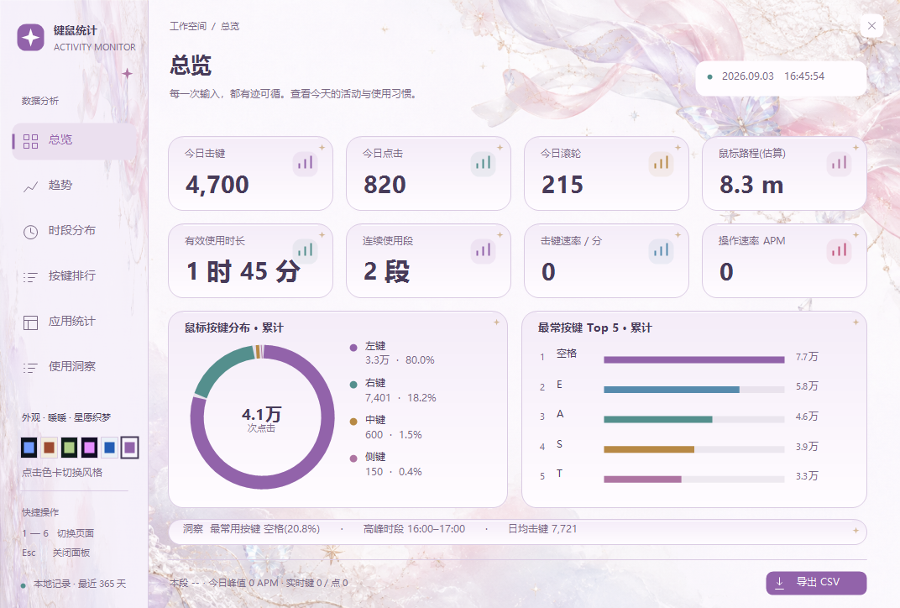
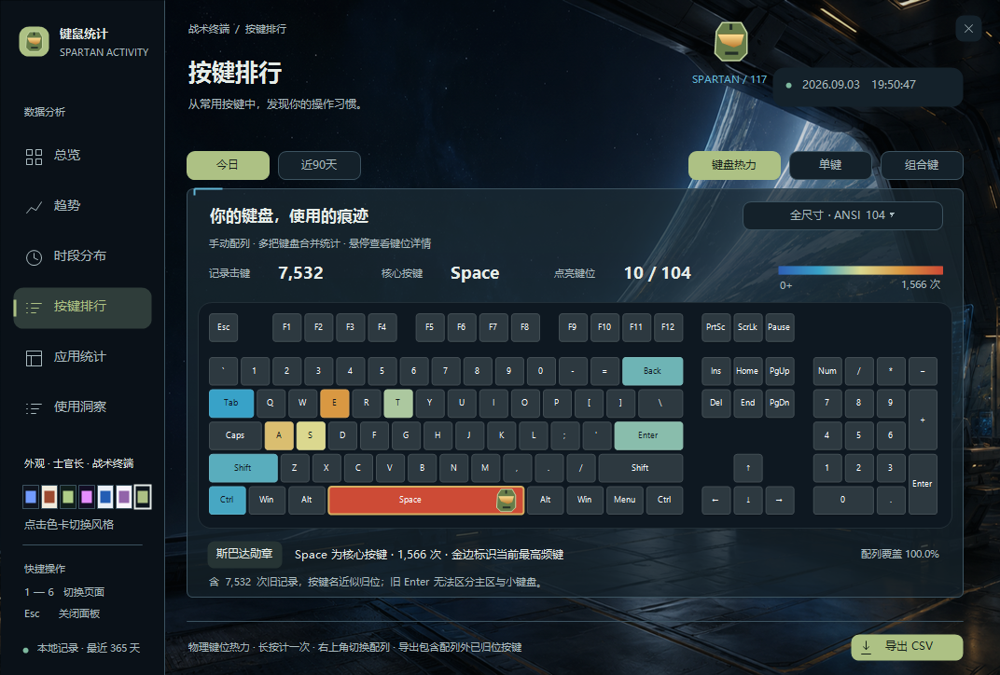

<h1 align="center">KeyMouseStats · 键鼠统计</h1>

<strong>在 Windows 桌面上记录键盘、鼠标与应用使用节奏，并把本地数据变成直观报告。</strong>

  
  
  
  

  <a href="https://github.com/2814899313/KeyMouseStats/releases/latest/download/KeyMouseStats.exe">下载完整版</a>
  · <a href="https://github.com/2814899313/KeyMouseStats/releases/latest/download/KeyMouseStats.Clean.exe">下载清爽版</a>
  · <a href="CHANGELOG.md">查看更新日志</a>
  · <a href="https://github.com/2814899313/KeyMouseStats/issues">报告问题</a>

## 它能做什么

KeyMouseStats 是一个单文件 Windows 桌面程序。悬浮小组件显示实时数据，详细面板负责回顾趋势、操作结构和使用习惯。

| 方向 | 能力 |
|---|---|
| 键盘 | 击键、逐键排行、组合键、键盘热力图、键位语义；按键排行页分「按键排行 / 组合键排行 / 全键热力图」三种主视图，时间与击键/按住时长作为二级筛选 |
| 鼠标 | 左右中侧键、滚轮、DPI 校准后的移动距离、移动方向、屏幕点击热区（32 像素网格 / 平滑热力双模式，跨屏全览或单屏放大，选中屏幕高亮与九宫格联动，位置明细保留 30 天） |
| 时间 | 活跃时长、空闲时段、连续使用段、24 小时分布（时段柱子 / 周 × 24 小时作息矩阵）、年度热力日历 |
| 趋势 | 按天趋势、近 2–14 天多曲线、本周七日小时曲线、异常日期标注、未运行日期灰带、整值 Y 轴、小时活跃时长 0–60 轴、击键/分与点击/分速率、今日进行中标注与「较昨日同期」环比 |
| 应用 | 前台应用归因、原生 exe 图标、可点击分类卡片筛选、自定义分类、应用 × APM 交叉分析、使用时长占比环图（悬停中心显示所选应用）、应用 × 时段、应用 × 操作、会话 × 应用 |
| 洞察 | 年度日历(近3月/半年/全年自适应)、会话时间轴(每小时刻度)、七日×24 矩阵(圆角格+迷你条)、操作密度、快捷键节省量、历史基准、分位数和统计报告 |
| 周期 | 区间回顾（近 7 天 / 30 天 / 本月 / 上季度 / 今年 / 自定义，可拖拽刷选）、对比区间（前一期 / 去年同期 / 自定义）、星期节律、分布与箱线图、导出 CSV / PNG / 自包含网页 |
| 联动 | 面板与报告互相跳转：报告里点「在面板中查看」带着日期回面板，面板里点「在报告中查看」带着页与区间进报告 |
| 数据 | 每日备份轮转、带校验和的导出、导入与多机合并（两种策略）、逐日数据校验；小组件「存储」页显示程序本体 / 历史备份 / 核心统计 / 日报归档的占用与占比，外部字符日志单列 |
| 目标 | 每日目标（击键 / 活跃时长）、小组件进度环、连续使用提醒、每日摘要（默认关闭） |
| 自启 | 开机自动启动（**默认关闭**，托盘菜单手动打开）：登记为当前用户的计划任务，开机并登录后自动拉起，指向的是你正在用的那个 exe |
| 日报 | 每天首次打开面板时自动生成昨日简报：核心数字与前 7 天日均对比、时段、应用 Top 5、操作习惯、字符内容，外加几句按数字触发的提醒；可保存 Markdown / 复制 |
| 输入深度 | 按住时长分布与逐键排行、应用 × 键位构成（1.7.3 起采集；按住时长不是按压力度） |
| 字符 | 输入法上屏内容（读本机 Rime `commit_log.csv`）：区间字数、日均/每分钟上屏、高频单字与词组（可仅看汉字/含标点）、最近上屏隐私模糊、词长 / 字符构成 / 输入节奏、每日/时段分布，刷新频率可配，可导出 CSV。**仅在小狼毫 + 雾凇拼音 + commit_log 插件同时具备时可用**，见[启用条件](#字符内容统计的启用条件) |
| 实时 | APM、最近五分钟微趋势、当前会话时长、游戏 HUD |

> 程序统计按键次数和组合关系，不记录实际输入文字。

## 立即使用

1. 从 [Releases](https://github.com/2814899313/KeyMouseStats/releases/latest) 选择版本：
   - **KeyMouseStats.exe**（约 22.6 MiB）：包含全部美术主题。
   - **KeyMouseStats.Clean.exe**（约 0.3 MiB）：保留全部统计功能，不包含皮肤图片和主题切换，体积更小。
2. 放到任意可写目录后运行，无需安装。
3. 双击桌面小组件打开数据分析；右键小组件打开托盘菜单。
4. 在设置中填写鼠标 DPI，获得更接近实际值的移动距离。

Windows 首次运行可能显示“未知发布者”，因为当前版本尚未使用商业代码签名证书。

### 常用操作

| 操作 | 结果 |
|---|---|
| 单击小组件 | 切换 今日 / 目标 / 累计 / 存储 |
| 双击小组件 | 打开数据分析 |
| 拖动小组件 | 调整桌面位置 |
| 右键小组件 | 打开功能菜单 |
| 托盘 → 窗口置顶 | 手动开启或关闭置顶，默认关闭 |
| 托盘 → 开机自动启动 | 登记／取消计划任务，默认关闭；开启后开机并登录即自动启动 |
| 托盘 → 游戏 HUD | 显示游戏内实时 APM、击键与本段时长 |

## 字符内容统计的启用条件

「字符内容」页**不是通用功能**，也不适用于所有输入法。只有同时满足以下三个条件时才可以使用：

1. 使用 Windows 版**小狼毫输入法（Weasel）**；
2. 输入方案为**雾凇拼音**（rime-ice）；
3. 安装并启用配套的 **commit_log 插件**（负责把每次上屏写入 `%APPDATA%\Rime\commit_log.csv`）。

三个条件缺任意一个，字符页都会显示「未找到 commit_log.csv」，其余键鼠统计不受影响。微软拼音、搜狗拼音、QQ 拼音等其他输入法**不支持**。

自检方法：打开 `%APPDATA%\Rime\commit_log.csv`，如果文件存在且在你输入后持续增长，就说明条件已满足；页面里的「重新读取」会立即刷新。

> 程序只**读取**这个 CSV 文件，不挂钩子、不读剪贴板、不写入该文件；字符数据不进入 `stats.txt`，也不参与导入合并与键鼠导出。

## 多日小时曲线

趋势页可将同一小时的多天数据放在一张图中：

- **昨天 / 上周同日**：两条曲线直接比较。
- **近 N 天**：N 可选 2–14，每天一条独立曲线。
- **本周 7 天**：按周一至周日展示，未来日期保持为空。
- 所选日使用主题主色粗线，其他日期使用独立颜色虚线。
- 悬停曲线区域可查看各日期在同一小时的具体数值。
- CSV 以日期为列导出，便于继续分析。

## 主题

程序内置 12 套主题。主题覆盖页面背景、卡片、图标、键盘热力和加载视觉；图片采用后台加载与有界缓存，背景与立绘以 JPEG 嵌入以控制体积。

<table>
<tr>
<td width="50%"> <b>暖暖 · 星愿织梦</b></td>
<td width="50%"> <b>士官长 · 战术终端</b></td>
</tr>
<tr>
<td width="50%"> <b>生化危机 · 生存档案</b></td>
<td width="50%"> <b>我的世界 · 方块世界</b></td>
</tr>
</table>

还包括小丑牌、大侠立志传及多套轻量配色主题。资源扩展方法见 [THEME_RESOURCES.md](THEME_RESOURCES.md)。

## 数据与隐私

- 数据只保存在当前 Windows 用户的本地应用数据目录。
- 不上传统计数据，不需要账户，也不依赖云服务。
- 默认保留最近 365 天，可从面板导出 CSV。
- 应用归因只记录前台进程、窗口标题及累计量。
- 「点击热区」只在本地把屏幕按 32 像素网格聚合点击次数：不截屏、不记录窗口内容、不记录点到了什么控件；位置明细只保留最近 30 天。
- 密码输入框和实际输入内容不在统计范围内。
- 「字符内容」页只**读取**输入法自己写的 `%APPDATA%\Rime\commit_log.csv`，程序不挂钩子、不读剪贴板、不写入该文件；该页仅在小狼毫 + 雾凇拼音 + commit_log 插件同时具备时可用（见[启用条件](#字符内容统计的启用条件)），且这些字符数据不进入 `stats.txt`，也不参与导入合并与键鼠导出。

更详细的安全说明见 [SECURITY.md](SECURITY.md)。

## 统计口径

- **活跃**：最近一次系统输入距离当前时间小于空闲阈值。
- **连续使用段**：在阈值内持续活跃的一段时间；锁屏、休眠和较长空闲会分段。
- **鼠标距离**：Raw Input 位移结合 DPI 换算；未设置 DPI 时只能视为估算。
- **长按按键**：一次物理按下只计一次，系统自动重复不会重复累计。
- **组合键**：修饰键按住时，普通键首次按下计为一次组合动作。
- **点击热区**：按虚拟桌面的物理像素每 32 像素一格计数；九宫格只统计当前选中的屏幕；位置明细保留 30 天；混合 DPI 布局的屏间空隙不计入任何屏幕。换过主屏或显示器布局后，旧位置按当时的桌面绝对坐标显示，不做重映射。
- **今日同期**：趋势页的环比只比昨日同一时段（只取双方已完成的整小时），日均只算完整日；今天的折线末段用虚线并标注「今日截至 HH:mm」。
- **未运行日期**：趋势页的灰色竖带表示该日没有落盘记录（应用/电脑未运行）；折线在此断开，日均与平均线不计这些日期。「有记录但当天没打字」仍显示 0 点。
- **整值刻度**：Y 轴按 1 / 1.5 / 2 / 2.5 / 3 / 4 / 5 / 6 / 8 / 10 × 10ⁿ 取步长，不再出现 3.61k 这类刻度；「每小时活跃时长」纵轴固定 0–60 分钟，刻度 0/15/30/45/60。
- **时段矩阵**：周 × 24 小时矩阵与时段柱子共用「今日 / 近 7 天 / 全部历史」筛选；每格是所选区间内「有记录日」按星期几与小时的平均值（默认不含今天）；柱子的颜色深浅与柱高同源。
- **历史基准**：至少需要 7 个有效历史日，缺失日期不会补零。

## 从源码构建

要求：Windows 10/11 与系统自带的 .NET Framework 4.x C# 编译器。

    build.bat

运行测试：

    test.bat

构建产物为根目录的 **KeyMouseStats.exe** 和 **KeyMouseStats.Clean.exe**。GitHub Actions 会在每次推送和 Pull Request 中独立构建两种版本。

## 项目导航

- [更新日志](CHANGELOG.md)
- [主题资源规范](THEME_RESOURCES.md)
- [隐私与安全](SECURITY.md)
- [参与开发](CONTRIBUTING.md)
- [2.1.0 发布说明](docs/releases/v2.1.0.md)
- [2.0.7 发布说明](docs/releases/v2.0.7.md)
- [2.0.6 发布说明](docs/releases/v2.0.6.md)
- [2.0.5 发布说明](docs/releases/v2.0.5.md)
- [2.0.2 发布说明](docs/releases/v2.0.2.md)
- [2.0.4 发布说明](docs/releases/v2.0.4.md)
- [2.0.3 发布说明](docs/releases/v2.0.3.md)
- [2.0.1 发布说明](docs/releases/v2.0.1.md)
- [2.0.0 发布说明](docs/releases/v2.0.0.md)
- [1.8.1 发布说明](docs/releases/v1.8.1.md)
- [1.8.0 发布说明](docs/releases/v1.8.0.md)
- [1.7.6 发布说明](docs/releases/v1.7.6.md)
- [1.7.5 发布说明](docs/releases/v1.7.5.md)
- [1.7.4 发布说明](docs/releases/v1.7.4.md)
- [1.7.3 发布说明](docs/releases/v1.7.3.md)
- [1.7.2 发布说明](docs/releases/v1.7.2.md)
- [1.7.1 发布说明](docs/releases/v1.7.1.md)
- [1.7.0 发布说明](docs/releases/v1.7.0.md)
- [1.6.0 发布说明](docs/releases/v1.6.0.md)
- [1.5.0 发布说明](docs/releases/v1.5.0.md)
- [1.4.0 发布说明](docs/releases/v1.4.0.md)
- [1.3.2 发布说明](docs/releases/v1.3.2.md)

## 参与项目

欢迎通过 [Issues](https://github.com/2814899313/KeyMouseStats/issues) 提交问题或建议。代码修改请先阅读 [CONTRIBUTING.md](CONTRIBUTING.md)，并确保没有提交个人统计数据、编译产物或批量测试截图。
